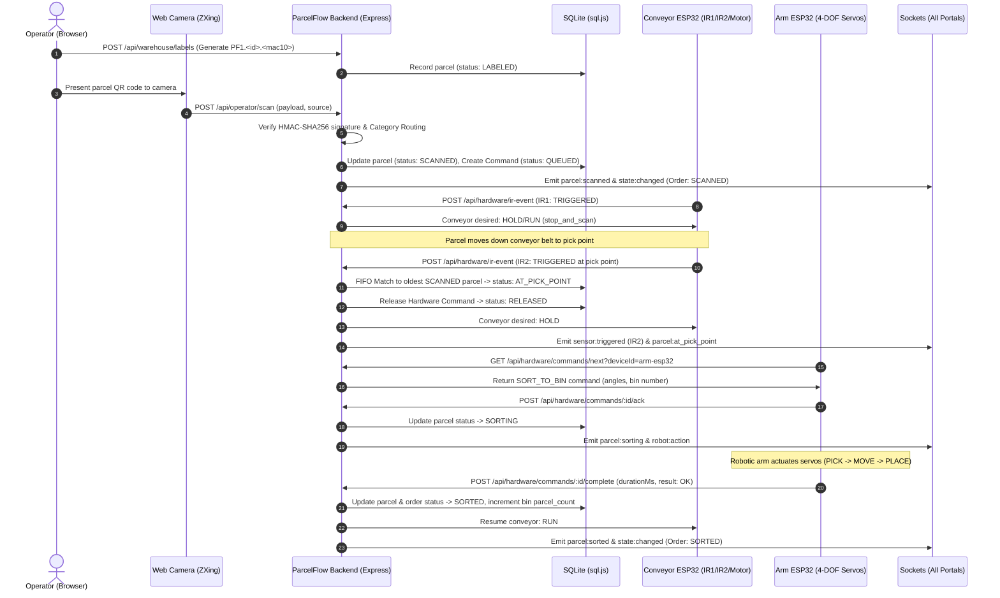

# ParcelFlow — Architecture Document

## 1. System Overview

ParcelFlow follows a monolithic full-stack architecture with a single Express server serving both the API backend and the Vite-powered React frontend. All three portals (Customer, Operator, Admin) share one backend, one database, and one real-time communication layer.

```
┌──────────────────────────────────────────────────┐
│                   BROWSER                         │
│  ┌─────────────┬─────────────┬─────────────┐     │
│  │  Customer   │  Operator   │    Admin    │     │
│  │   Portal    │   Portal    │   Portal    │     │
│  └──────┬──────┴──────┬──────┴──────┬──────┘     │
│         │  React 19 + Vite 6 + TailwindCSS 4     │
│         └─────────────┬─────────────┘             │
│                       │ HTTP + WebSocket          │
└───────────────────────┼──────────────────────────┘
                        │
┌───────────────────────┼──────────────────────────┐
│              EXPRESS SERVER (Node.js)              │
│  ┌────────────────────┼────────────────────┐     │
│  │            API Router (routes.ts)       │     │
│  │  ┌──────────┐ ┌──────────┐ ┌─────────┐ │     │
│  │  │Auth      │ │Warehouse │ │Admin    │ │     │
│  │  │Middleware │ │Endpoints │ │Endpoints│ │     │
│  │  └──────────┘ └──────────┘ └─────────┘ │     │
│  └────────────────────┼────────────────────┘     │
│  ┌────────────────────┼────────────────────┐     │
│  │         Socket.io Server                │     │
│  └────────────────────┼────────────────────┘     │
│  ┌────────────────────┼────────────────────┐     │
│  │     Hardware Simulator Engine           │     │
│  └────────────────────┼────────────────────┘     │
│                       │                           │
│  ┌────────────────────┼────────────────────┐     │
│  │         SQLite (sql.js)                 │     │
│  │         parcelflow.sqlite               │     │
│  └─────────────────────────────────────────┘     │
└──────────────────────────────────────────────────┘
                        │
                  (Future Integration)
                        │
┌───────────────────────┼──────────────────────────┐
│              HARDWARE LAYER                       │
│  ┌─────────┐  ┌──────────┐  ┌───────────────┐   │
│  │  ESP32  │──│ IR Sensor│──│ Conveyor Motor│   │
│  └────┬────┘  └──────────┘  └───────────────┘   │
│       │                                           │
│  ┌────┴────┐  ┌──────────────────────────┐       │
│  │ Camera  │  │ Robotic Arm (Servos)     │       │
│  │ OpenCV  │  │ Sorting Mechanism        │       │
│  └─────────┘  └──────────────────────────┘       │
└──────────────────────────────────────────────────┘
```

---

## 2. Technology Stack

| Layer | Technology |
|---|---|
| Frontend Framework | React 19 with TypeScript |
| Build Tool | Vite 6 |
| CSS Framework | Tailwind CSS 4 (via `@tailwindcss/vite` plugin) |
| Icons | Lucide React |
| Charts | Recharts |
| Animations | Motion (Framer Motion) |
| Backend Runtime | Node.js (tsx for TypeScript execution) |
| HTTP Server | Express 4 |
| Database | SQLite via `sql.js` (in-memory, persisted to `parcelflow.sqlite`) |
| Real-time | Socket.io (server + client) |
| Authentication | Custom JWT (HMAC-SHA256) + PBKDF2 password hashing + Firebase Google Sign-In |
| Production Build | Vite (frontend) + esbuild (server) |

---

## 3. Directory Structure

```
parcelflow/
├── server.ts                    # Express + Socket.io entry point
├── src/
│   ├── App.tsx                  # Root component with AuthProvider and route guards
│   ├── main.tsx                 # React DOM entry
│   ├── index.css                # Tailwind CSS import
│   ├── types.ts                 # Shared TypeScript type definitions
│   ├── server/
│   │   ├── auth.ts              # JWT, PBKDF2 hashing, auth middleware
│   │   ├── db.ts                # SQLite initialization, schema, migrations
│   │   ├── routes.ts            # All REST API endpoints
│   │   ├── seed.ts              # Demo data seeding
│   │   ├── orderStateMachine.ts # Order status transition logic
│   │   └── hardware-simulator/
│   │       └── index.ts         # Conveyor/sensor/robot simulation engine
│   ├── portals/
│   │   ├── auth/
│   │   │   └── LoginPage.tsx    # Unified login/signup/forgot/reset page
│   │   ├── customer/
│   │   │   ├── CustomerPortal.tsx
│   │   │   ├── components/      # CustomerHeader, CartDrawer
│   │   │   └── pages/           # Home, Catalog, ProductDetail, Checkout,
│   │   │                        # Orders, Tracking, Invoice, Wishlist, Profile
│   │   ├── operator/
│   │   │   ├── OperatorPortal.tsx
│   │   │   ├── components/      # OperatorHeader, OperatorSidebar
│   │   │   └── pages/           # Dashboard, OrdersQueue, Picking, Packing,
│   │   │                        # Conveyor, Inventory, Alerts, Logs
│   │   └── admin/
│   │       ├── AdminPortal.tsx
│   │       ├── components/      # AdminHeader, AdminSidebar
│   │       └── pages/           # Analytics, Catalog, Inventory, Orders,
│   │                            # Billing, MachineAnalytics, Destinations, Settings
│   └── shared/
│       ├── components/          # Button, Card, Drawer, Modal, Table, Tabs, etc.
│       ├── layouts/             # PortalSwitcherHeader (global top bar)
│       ├── lib/
│       │   ├── api.ts           # apiFetch utility with auth headers
│       │   ├── firebase.ts      # Firebase Modular Web SDK initialization
│       │   ├── socket.ts        # Socket.io client singleton
│       │   └── formatters.ts    # Date, currency, number formatters
│       └── store/
│           ├── authContext.tsx   # AuthProvider with login/register/google/logout
│           └── toastContext.tsx  # Toast notification system
├── parcelflow.sqlite            # Persisted SQLite database file
├── .env                         # Environment configuration
└── package.json
```

---

## 4. Authentication Architecture

### Flow

1. **Login:** Client sends `POST /api/auth/login` with email + password → Server verifies password against PBKDF2 hash → Returns JWT token + user object.
2. **Registration:** Client sends `POST /api/auth/register` with name, email, password → Server creates user with hashed password → Returns JWT + user.
3. **Session Persistence:** JWT token and user object stored in `localStorage`. Restored on page refresh via `AuthProvider` initial state.
4. **API Authorization:** Every authenticated request includes `Authorization: Bearer <token>` header. Server middleware (`extractUserFromRequest`) decodes and verifies the JWT.
5. **Password Reset:** Client sends email to `POST /api/auth/forgot-password` → Server generates 6-digit token → Client submits token + new password to `POST /api/auth/reset-password`.

### JWT Structure

```
Header:  { alg: "HS256", typ: "JWT" }
Payload: { id, email, role, name, iat, exp }  (7-day expiry)
Signature: HMAC-SHA256(header.payload, JWT_SECRET)
```

### Password Hashing

```
PBKDF2(password, random_16byte_salt, 10000_iterations, 64_bytes, SHA-512)
Stored as: salt:hash
```

---

## 5. Role-Based Access Control

### Frontend Guards (App.tsx)

- Unauthenticated users → redirected to `/login`
- Authenticated users → restricted to their role's portal path
- `customer` → `/customer/*` only
- `operator` → `/operator/*` only
- `admin` → `/admin/*` only

### Backend Middleware (routes.ts)

| Middleware | Access Level |
|---|---|
| `requireUser` | Any authenticated user |
| `requireStaff` | Operator or Admin only |
| `requireAdmin` | Admin only |

### Data Isolation

- Customer orders: SQL `WHERE o.customer_id = ?` using authenticated user's ID
- Customer cart: SQL `WHERE c.customer_id = ?`
- Customer addresses: SQL `WHERE customer_id = ?`
- Invoice access: Verified `invoice.customer_id === user.id` for customers

---

## 6. Database Schema

The SQLite database contains the following tables:

| Table | Purpose |
|---|---|
| `users` | All user accounts (customer, operator, admin) |
| `categories` | Product categories |
| `products` | Product catalog |
| `reviews` | Product reviews |
| `wishlist_items` | Customer wishlists |
| `cart_items` | Shopping cart |
| `addresses` | Customer shipping addresses |
| `orders` | Order records |
| `order_items` | Line items per order |
| `order_status_history` | Audit trail of status transitions |
| `invoices` | GST invoice records |
| `inventory` | Stock quantities and thresholds |
| `picking_tasks` | Warehouse picking assignments |
| `packing_tasks` | Warehouse packing records |
| `destinations` | City-to-bin mappings for sorting |
| `sorting_logs` | Records of sorting operations |
| `machine_status_log` | Hardware status audit trail |
| `alerts` | System alerts (low stock, machine faults) |
| `expenses` | Warehouse operating expenses |
| `password_reset_tokens` | Password reset token records |

---

## 7. Real-Time Communication (Socket.io)

### Server → Client Events

| Event | Data | Purpose |
|---|---|---|
| `machine:status` | `MachineState` | Broadcast every 2s |
| `sensor:triggered` | `{ orderId }` | IR sensor detected parcel |
| `camera:frame` | `{ orderId, dimensions, barcode }` | Camera capture data |
| `robot:action` | `{ orderId, action, targetBin }` | Robotic arm step |
| `sorting:completed` | `{ orderId, bin, result, durationMs }` | Sort result |
| `order:status:changed` | `{ orderId, oldStatus, newStatus }` | Order transition |
| `alert:created` | Alert object | New system alert |
| `inventory:low_stock` | `{ productId, stockQuantity }` | Low stock warning |

### Client → Server Events

| Event | Data | Purpose |
|---|---|---|
| `conveyor:start` | — | Start conveyor motor |
| `conveyor:stop` | — | Stop conveyor |
| `conveyor:pause` | — | Pause conveyor |
| `conveyor:emergency_stop` | — | Emergency stop all |
| `debug:simulate_fault` | `{ target }` | Inject hardware fault |

---

## 8. Hardware Simulation Engine

The hardware simulator (`src/server/hardware-simulator/index.ts`) models the physical sorting pipeline:

```
IR Sensor Trigger (1.8s)
    ↓
Status: DETECTED
    ↓
### Physical Pipeline Architecture & Real Hardware Integration

ParcelFlow supports dual operational modes:
- **`HARDWARE_MODE=real`**: Real hardware pipeline driven by microcontrollers (ESP32) and live camera feed via `navigator.mediaDevices.getUserMedia`.
- **`HARDWARE_MODE=simulator`**: Synchronous digital twin hardware simulator with full event broadcast.



---

## 9. Order State Machine

```
PLACED → CONFIRMED → PICKING → PICKED → PACKING → PACKED
                                                      ↓
                                                ON_CONVEYOR
                                                      ↓
                                                   SCANNED   (Optical QR Code verified)
                                                      ↓
                                                  DETECTED   (IR2 pick point break-beam)
                                                      ↓
                                                   SORTING   (Robotic arm picking & placing)
                                                      ↓
                                                   SORTED    (Placed into category destination bin)
                                                      ↓
                                                DISPATCHED → DELIVERED

Any* → CANCELLED
DELIVERED → RETURN_REQUESTED → RETURN_APPROVED / RETURN_REJECTED
```

State transitions are strictly enforced by `orderStateMachine.ts` which validates transition legitimacy before committing changes to the database.

---

## 10. API Structure

All endpoints are hosted under `/api/`:

| Prefix | Purpose | Auth Level |
|---|---|---|
| `/api/auth/*` | Login, register, forgot/reset password, Google login | Public / Rate-limited |
| `/api/hardware/*` | ESP32 device API (heartbeat, IR events, command queue, conveyor state) | `requireDeviceToken` |
| `/api/operator/*` | Operator live pipeline, camera scan, E-Stop, label studio | `requireStaff` |
| `/api/catalog/*` | Product catalog, categories, reviews | Public (read) / Auth (write) |
| `/api/cart/*` | Shopping cart CRUD | `requireUser` |
| `/api/wishlist/*` | Wishlist management | `requireUser` |
| `/api/addresses/*` | Address CRUD | `requireUser` |
| `/api/orders/*` | Order creation, viewing, customer tracking | `requireUser` |
| `/api/invoices/*` | GST invoice retrieval | `requireUser` |
| `/api/warehouse/*` | Queue, picking, packing, conveyor, alerts | `requireStaff` |
| `/api/inventory/*` | Stock & rack location management | `requireStaff` |
| `/api/analytics/*` | Dashboard analytics (excludes demo orders from revenue) | `requireAdmin` |
| `/api/admin/*` | User management & 4-DOF servo bin configuration | `requireAdmin` |

---

## 11. Deployment Architecture

### Development

```bash
npm run dev    # tsx server.ts (Express + Vite middleware)
```

Express serves the Vite dev server as middleware, providing HMR for frontend and a single port for both API and UI.

### Production

```bash
npm run build  # vite build + esbuild server bundle
npm start      # node dist/server.cjs (serves static dist/)
```

In production, the Express server serves the pre-built static frontend from `dist/` and handles API routes.
